

<!-- pixel:header -->
<picture><source media="(prefers-color-scheme: dark)" srcset="pixel-art/sky-left-dark.svg">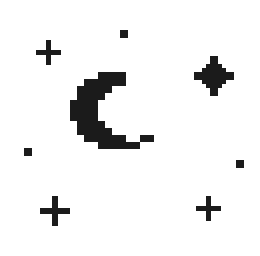</picture>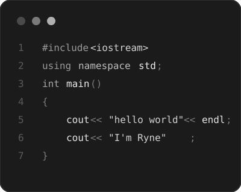<picture><source media="(prefers-color-scheme: dark)" srcset="pixel-art/sky-right-dark.svg">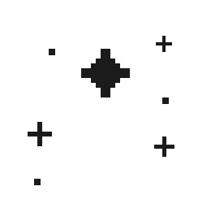</picture>
<!-- /pixel:header -->

<picture><source media="(prefers-color-scheme: dark)" srcset="assets/hero-dark.svg"></picture>

<!-- pixel:dots -->
<picture><source media="(prefers-color-scheme: dark)" srcset="pixel-art/divider-dots-dark.svg"></picture>
<!-- /pixel:dots -->

<picture><source media="(prefers-color-scheme: dark)" srcset="assets/about-dark.svg"></picture>

<picture><source media="(prefers-color-scheme: dark)" srcset="assets/social-l-dark.svg"></picture><a href="https://discord.gg/YKhWXXhKmC"><picture><source media="(prefers-color-scheme: dark)" srcset="assets/social-1-dark.svg"></picture></a><a href="https://tiktok.com/@rynekryz"><picture><source media="(prefers-color-scheme: dark)" srcset="assets/social-2-dark.svg"></picture></a><picture><source media="(prefers-color-scheme: dark)" srcset="assets/social-r-dark.svg"></picture>

<picture><source media="(prefers-color-scheme: dark)" srcset="assets/stack-dark.svg"></picture>

<!-- pixel:sparkles -->
<picture><source media="(prefers-color-scheme: dark)" srcset="pixel-art/divider-sparkles-dark.svg"></picture>
<!-- /pixel:sparkles -->

<a href="https://github.com/rynekryz/sniffsniff"><picture><source media="(prefers-color-scheme: dark)" srcset="assets/project-sniffsniff-dark.svg"></picture></a>&nbsp;<a href="https://github.com/rynekryz/exiless"><picture><source media="(prefers-color-scheme: dark)" srcset="assets/project-exiless-dark.svg"></picture></a>

<a href="https://github.com/rynekryz/melissm"><picture><source media="(prefers-color-scheme: dark)" srcset="assets/project-melissm-dark.svg"></picture></a>&nbsp;<a href="https://github.com/rynekryz/rynotes"><picture><source media="(prefers-color-scheme: dark)" srcset="assets/project-rynotes-dark.svg"></picture></a>

<a href="https://github.com/rynekryz/graphyte"><picture><source media="(prefers-color-scheme: dark)" srcset="assets/project-graphyte-dark.svg"></picture></a>&nbsp;<a href="https://github.com/rynekryz/portfolio"><picture><source media="(prefers-color-scheme: dark)" srcset="assets/project-portfolio-dark.svg"></picture></a>

<a href="https://github.com/rynekryz/webgl-raytracing-test"><picture><source media="(prefers-color-scheme: dark)" srcset="assets/project-webgl-raytracing-test-dark.svg"></picture></a>&nbsp;<a href="https://github.com/rynekryz/dormguard"><picture><source media="(prefers-color-scheme: dark)" srcset="assets/project-dormguard-dark.svg"></picture></a>

<!-- pixel:wave -->
<picture><source media="(prefers-color-scheme: dark)" srcset="pixel-art/divider-wave-dark.svg"></picture>
<!-- /pixel:wave -->

<picture><source media="(prefers-color-scheme: dark)" srcset="assets/stats-dark.svg"></picture>

<picture><source media="(prefers-color-scheme: dark)" srcset="assets/streak-dark.svg"></picture>

<picture><source media="(prefers-color-scheme: dark)" srcset="assets/wave-dark.svg"></picture>

<!-- pixel:stickers -->
<table align="center">
<tr>
<td><picture><source media="(prefers-color-scheme: dark)" srcset="pixel-art/sticker-heart-dark.svg">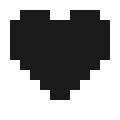</picture></td>
<td><picture><source media="(prefers-color-scheme: dark)" srcset="pixel-art/sticker-sparkle-dark.svg">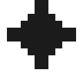</picture></td>
<td><picture><source media="(prefers-color-scheme: dark)" srcset="pixel-art/sticker-moon-dark.svg">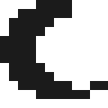</picture></td>
<td><picture><source media="(prefers-color-scheme: dark)" srcset="pixel-art/sticker-flower-dark.svg">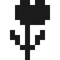</picture></td>
<td><picture><source media="(prefers-color-scheme: dark)" srcset="pixel-art/sticker-cat-dark.svg">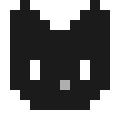</picture></td>
<td><picture><source media="(prefers-color-scheme: dark)" srcset="pixel-art/sticker-ghost-dark.svg">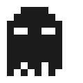</picture></td>
<td><picture><source media="(prefers-color-scheme: dark)" srcset="pixel-art/sticker-lock-dark.svg"></picture></td>
</tr>
</table>
<!-- /pixel:stickers -->

<a href="https://rynekryz.github.io"><picture><source media="(prefers-color-scheme: dark)" srcset="assets/button-1-dark.svg"></picture></a>&nbsp;&nbsp;<a href="https://github.com/rynekryz?tab=repositories"><picture><source media="(prefers-color-scheme: dark)" srcset="assets/button-2-dark.svg"></picture></a>

<a href="https://metawka.github.io/expressive-profile/?from=rynekryz"><picture><source media="(prefers-color-scheme: dark)" srcset="assets/credit-dark.svg"></picture></a>

