

  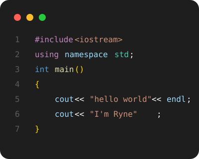

<picture><source media="(prefers-color-scheme: dark)" srcset="assets/hero-dark.svg"></picture>

<picture><source media="(prefers-color-scheme: dark)" srcset="assets/about-dark.svg"></picture>

<picture><source media="(prefers-color-scheme: dark)" srcset="assets/social-l-dark.svg"></picture><a href="https://discord.gg/YKhWXXhKmC"><picture><source media="(prefers-color-scheme: dark)" srcset="assets/social-1-dark.svg"></picture></a><a href="https://tiktok.com/rynekryz"><picture><source media="(prefers-color-scheme: dark)" srcset="assets/social-2-dark.svg"></picture></a><picture><source media="(prefers-color-scheme: dark)" srcset="assets/social-r-dark.svg"></picture>

<picture><source media="(prefers-color-scheme: dark)" srcset="assets/stack-dark.svg"></picture>

<a href="https://github.com/rynekryz/rynotes"><picture><source media="(prefers-color-scheme: dark)" srcset="assets/project-rynotes-dark.svg"></picture></a>&nbsp;<a href="https://github.com/rynekryz/webgl-raytracing-test"><picture><source media="(prefers-color-scheme: dark)" srcset="assets/project-webgl-raytracing-test-dark.svg"></picture></a>

<a href="https://github.com/rynekryz/dormguard"><picture><source media="(prefers-color-scheme: dark)" srcset="assets/project-dormguard-dark.svg"></picture></a>&nbsp;<a href="https://github.com/rynekryz/ZenPixl"><picture><source media="(prefers-color-scheme: dark)" srcset="assets/project-zenpixl-dark.svg"></picture></a>

<picture><source media="(prefers-color-scheme: dark)" srcset="assets/stats-dark.svg"></picture>

<picture><source media="(prefers-color-scheme: dark)" srcset="assets/streak-dark.svg"></picture>

<picture><source media="(prefers-color-scheme: dark)" srcset="assets/wave-dark.svg"></picture>

<a href="https://rynekryz.github.io"><picture><source media="(prefers-color-scheme: dark)" srcset="assets/button-1-dark.svg"></picture></a>&nbsp;&nbsp;<a href="https://github.com/rynekryz?tab=repositories"><picture><source media="(prefers-color-scheme: dark)" srcset="assets/button-2-dark.svg"></picture></a>

<a href="https://metawka.github.io/expressive-profile/?from=rynekryz"><picture><source media="(prefers-color-scheme: dark)" srcset="assets/credit-dark.svg"></picture></a>

