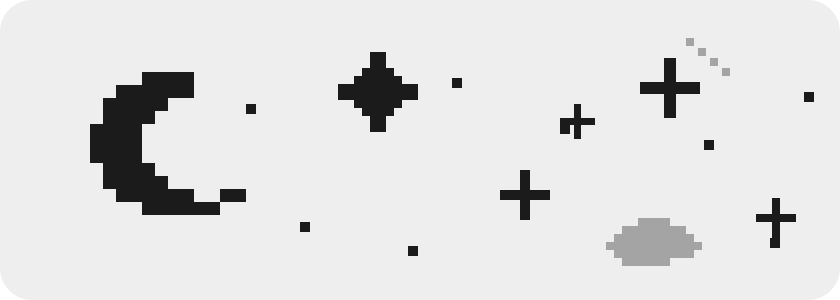
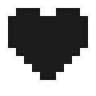
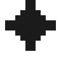
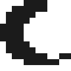
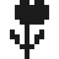
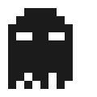

<div align="center">

# Pixel Art

Monochrome, animated pixel sky, dividers, and stickers for my profile.

<picture><source media="(prefers-color-scheme: dark)" srcset="divider-wave-dark.svg"></picture>

## Dividers

<picture><source media="(prefers-color-scheme: dark)" srcset="divider-dots-dark.svg"></picture>

<picture><source media="(prefers-color-scheme: dark)" srcset="divider-sparkles-dark.svg"></picture>

<picture><source media="(prefers-color-scheme: dark)" srcset="divider-wave-dark.svg"></picture>

## Sky

<picture><source media="(prefers-color-scheme: dark)" srcset="sky-banner-dark.svg"></picture>

## Stickers

| <picture><source media="(prefers-color-scheme: dark)" srcset="sticker-heart-dark.svg"></picture> | <picture><source media="(prefers-color-scheme: dark)" srcset="sticker-sparkle-dark.svg"></picture> | <picture><source media="(prefers-color-scheme: dark)" srcset="sticker-moon-dark.svg"></picture> | <picture><source media="(prefers-color-scheme: dark)" srcset="sticker-flower-dark.svg"></picture> |
| :---: | :---: | :---: | :---: |
| <picture><source media="(prefers-color-scheme: dark)" srcset="sticker-cat-dark.svg"></picture> | <picture><source media="(prefers-color-scheme: dark)" srcset="sticker-ghost-dark.svg"></picture> | <picture><source media="(prefers-color-scheme: dark)" srcset="sticker-lock-dark.svg"></picture> | |

## Usage

Keep the SVGs in `pixel-art/` and drop a block into the profile README.

Divider:

```html
<picture><source media="(prefers-color-scheme: dark)" srcset="pixel-art/divider-wave-dark.svg"></picture>
```

Sticker:

```html
<picture><source media="(prefers-color-scheme: dark)" srcset="pixel-art/sticker-cat-dark.svg"></picture>
```

## Files

```text
pixel-art
├── divider-dots-dark.svg
├── divider-dots-light.svg
├── divider-sparkles-dark.svg
├── divider-sparkles-light.svg
├── divider-wave-dark.svg
├── divider-wave-light.svg
├── sky-banner-dark.svg
├── sky-banner-light.svg
├── sticker-cat-dark.svg
├── sticker-cat-light.svg
├── sticker-flower-dark.svg
├── sticker-flower-light.svg
├── sticker-ghost-dark.svg
├── sticker-ghost-light.svg
├── sticker-heart-dark.svg
├── sticker-heart-light.svg
├── sticker-lock-dark.svg
├── sticker-lock-light.svg
├── sticker-moon-dark.svg
├── sticker-moon-light.svg
├── sticker-sparkle-dark.svg
└── sticker-sparkle-light.svg
```

## Notes

All art is pure SVG, no dependencies. Every piece comes in a light and a dark version, so it stays monochrome on both GitHub themes. Animations use `steps()` for a chunky retro feel and turn off with `prefers-reduced-motion`.

</div>
